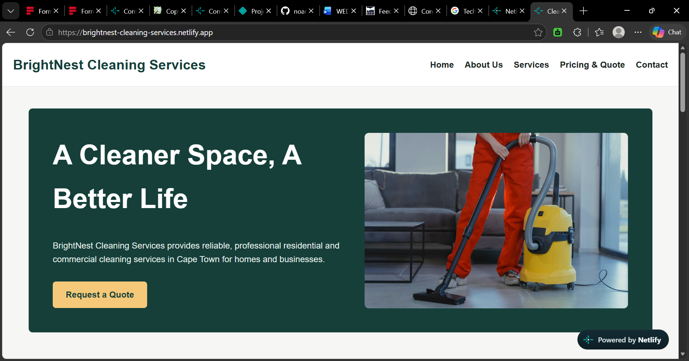
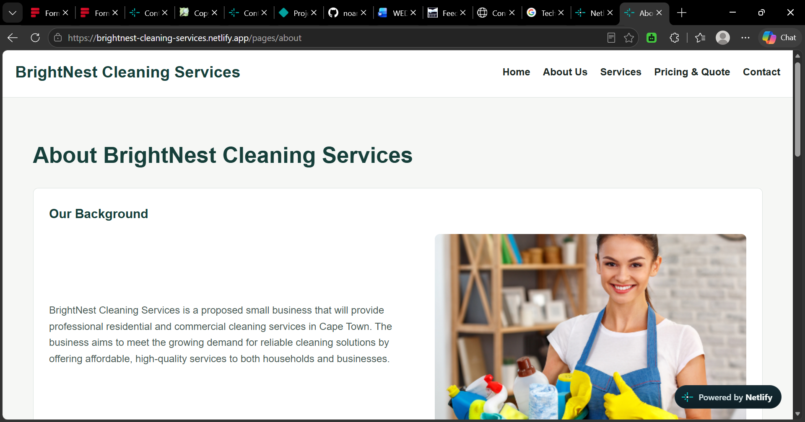
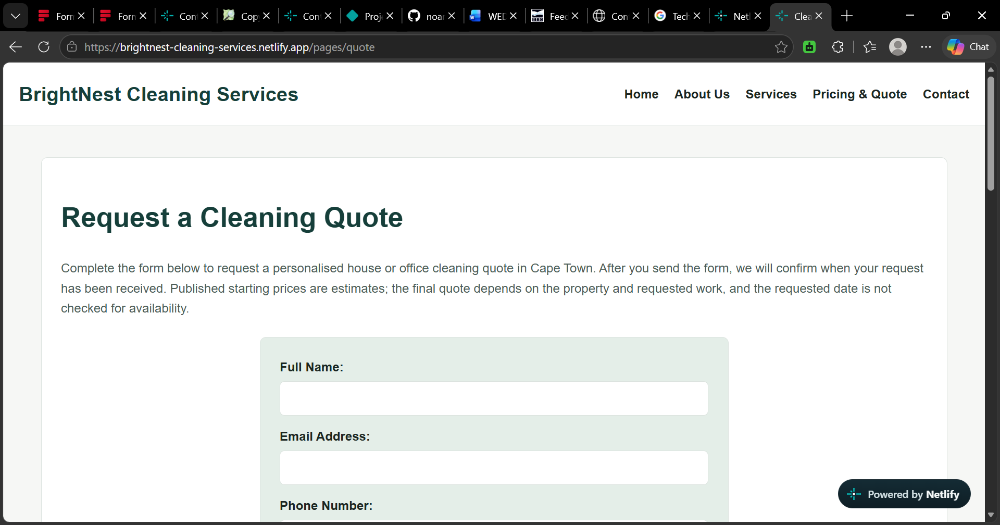
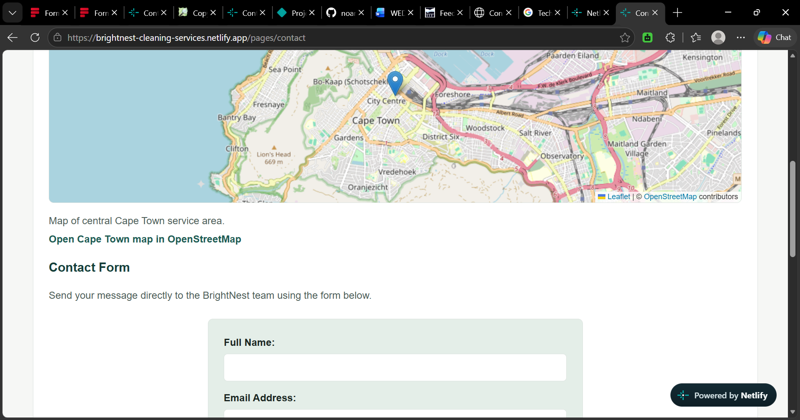
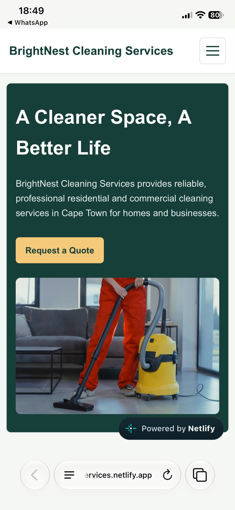

# BrightNest Cleaning Services Website

## Student Information

**Student Name:** MULENGA NOAM KABEKE

**Student Number:** ST10517736

**Module:** WEDE5020

**Programme:** HMAW0501

**Institution:** ROSEBANK INTERNATIONAL COLLEGE

**Year:** 2026

---

## Project Overview

BrightNest Cleaning Services is a proposed cleaning services website developed as part of the WEDE web development project.

The website is designed for a fictional cleaning organisation based in Cape Town. The purpose of the website is to provide customers with clear information about the organisation, its cleaning services, proposed pricing and contact options.

The website is aimed at residential customers, professionals, students and small businesses that may require professional cleaning services.

The website will use a simple and clear structure to help users find information about available services and request a quotation.

The website includes responsive styling and interactive features such as an FAQ accordion, a project gallery lightbox, scroll-reveal effects, page sharing and an OpenStreetMap-powered Cape Town service-area map.

---

## Website Goals and Objectives

### Goals

The main goals of the BrightNest Cleaning Services website are:

- Establish an online presence for the organisation.
- Provide customers with information about cleaning services.
- Make it easy for customers to request a quotation.
- Provide clear contact information.
- Build customer trust through testimonials and examples of completed work.
- Create a simple and easy-to-navigate website.

### Objectives

The website objectives are:

- Develop a five-page website using HTML.
- Provide information about seven cleaning services.
- Include proposed starting prices.
- Provide a quotation request form.
- Provide contact and business information.
- Include customer testimonials and a gallery preview.
- Provide frequently asked questions.
- Create clear navigation between all five pages.
- Organise website files using a clear folder structure.
- Maintain the project using Git and GitHub.

---

## Key Features and Functionality

The website will include the following features:

### Home Page

- Company introduction
- Hero section
- Call-to-action
- Services overview
- Why Choose Us section
- Customer testimonials
- Gallery preview
- Request a Quote button
- Contact information

### About Us Page

- Company background
- Mission statement
- Vision statement
- Core values
- Service areas
- Customer satisfaction commitment

### Services Page

The Services page will provide information about:

- Residential cleaning
- Office cleaning
- Deep cleaning
- Move-in and move-out cleaning
- Carpet cleaning
- Upholstery cleaning
- Window cleaning

Each service will provide a description, benefits, estimated duration and proposed starting price.

The service cards can be searched and sorted by name or starting price. The service list remains available when JavaScript is disabled.

### Search and On-Page SEO

- Each page has a distinct title and meta description.
- Main page headings use a clear heading hierarchy, with descriptive image alt text and filenames.
- Existing navigation and service-to-quote links connect related pages.
- Descriptive `.html` page paths are retained for simple static hosting; the referenced image filenames use lowercase, hyphenated names.
- Service listings can be filtered by search text and sorted by name or price.
- On screens 600px wide or narrower, the page links collapse into an accessible hamburger menu; larger screens keep the full navigation visible.
- `robots.txt` allows crawlers to access the website and points to the root `sitemap.xml`.
- Below-the-fold gallery, testimonial and service images use lazy loading; image dimensions are declared where useful to reduce layout shifts.
- JavaScript is loaded with `defer`, external map library files use Subresource Integrity, and external new-tab links use `noopener noreferrer`.

Keyword phrases were selected from Google autocomplete suggestions for Cape Town cleaning searches and aligned with the services offered. Suggestions included “cleaning services Cape Town,” “cleaning services Cape Town prices,” “house cleaning Cape Town” and “deep cleaning services Cape Town.” These are directional query suggestions, not search-volume estimates.

### Pricing and Quote Page

- Proposed service prices and frequently asked questions
- Quote enquiry form for customer contact details, service, preferred date, property type and area, room/work-area count, and additional requirements
- Client-side required-field, email, phone, date and numeric-range validation
- Submits the request to Formspree and, after confirmed receipt, displays the selected service's published starting price and explains that availability is not checked and the final amount depends on the work requested

### Contact Page

- Telephone number
- Email address
- Contact form
- Business operating hours
- Cape Town service-area map with an OpenStreetMap link
- Separate contact form with name, email, phone, message type and a 20–2000 character message
- Client-side validation and AJAX submission to Formspree

### Form Delivery and Validation

Both forms use native HTML constraints and JavaScript feedback, then submit independently with `fetch()` to Formspree. The contact form uses `https://formspree.io/f/mbggaral`; the quote form uses `https://formspree.io/f/xvkkbpqe`. The forms display success only when Formspree returns a successful JSON confirmation, and keep the entered details if submission fails. In the Formspree dashboard, configure and verify `noamekabeke@gmail.com` as the notification recipient for both endpoints. Recipient routing cannot be configured securely from the public website. Deploy the site over HTTPS and test each endpoint after confirming the Formspree account's activation and any required email verification. Do not put email-service API keys or secrets in client-side JavaScript.

---

## Design and User Experience

The BrightNest website will use a simple and clear design to make it easy for customers to find information about cleaning services.

The website will have consistent navigation across all five pages. The content will be organised into clear sections with headings and readable text.

The design will focus on usability, accessibility and a simple user experience. The website will also use appropriate images to support the content and help users understand the services offered.

The website will be designed with different users in mind, including residential customers, professionals, students and small businesses.

A colour palette of deep teal, warm amber and light neutral tones was chosen to reflect trust, professionalism and cleanliness. Typography uses a clear sans-serif type scale for readability across devices.

---

## Wireframes

Basic wireframes were created during the planning stage to show the proposed structure and layout of the website pages.

The wireframes show the main areas of each page, including:

- Header and navigation
- Main content
- Service information
- Forms and call-to-action buttons
- Contact information
- Footer

The wireframes were used as a guide when developing the HTML structure of the website.

---

## Technical Requirements

The following technologies and tools are used for the project:

- HTML5 for the website structure
- CSS3 for styling and responsive design, including Flexbox and CSS Grid layout
- Visual Studio Code for writing and editing code
- Git for version control
- GitHub for repository management
- Web browser and browser developer tools for testing the website
- Image assets from Pexels
- Google Fonts for typography
- Random User Generator for placeholder testimonial avatars

The website uses HTML5, CSS3 and vanilla JavaScript. Leaflet and OpenStreetMap provide the interactive map; the rest of the interactions do not require a framework. The map pin marks central Cape Town as a general service-area reference because the fictional business has no public street address.

The Our Work gallery includes locally stored photographs from Unsplash, used under the [Unsplash License](https://unsplash.com/license). Photo credits: [Vitaly Gariev](https://unsplash.com/@silverkblack), [Giorgio Trovato](https://unsplash.com/@giorgiotrovato) and [Towfiqu barbhuiya](https://unsplash.com/@towfiqu999999).

### Section 3.2: Off-Page and Local SEO

- The homepage includes Schema.org `Organization` JSON-LD for the proposed business name, stated Cape Town service area and services. It intentionally omits an address, map coordinates, phone number, public website URL and social profiles because these have not been verified as real business details. This describes the organization and does not qualify it for LocalBusiness address-based rich results.
- The Contact page retains the Leaflet/OpenStreetMap map and labels its central Cape Town marker as a general service-area reference, not a business address. Cape Town is the only service area named on the site; confirm individual neighborhood coverage before advertising it.
- The footer uses the browser's native share sheet where supported, with a clipboard fallback. Sharing requires a public HTTPS deployment (or localhost during development). No social profile links are included because no account URLs have been provided.
- No backlinks or directory listings have been created. Once a real business is operating and its details and eligibility are confirmed, legitimate opportunities include a [Google Business Profile](https://support.google.com/business/answer/9157481?hl=en) configured as a service-area business when applicable, a relevant [Snupit](https://www.snupit.co.za/) service-provider listing and a [Brabys](https://www.brabys.com/) business listing. Also consider genuine local chamber, neighborhood, supplier or community-organization pages when BrightNest has an actual relationship or membership. Follow each platform's current eligibility and listing rules.
- Use accurate, consistent business name, verified contact details and service area across approved listings. The Contact page currently shows two phone numbers, while older footer content used a different number; the conflicting footer number has been removed. Confirm which contact numbers are current before adding them to external profiles or structured data.
- Earn links through real customer, supplier, community or sponsorship relationships and useful local information. Do not buy links, create fake listings, use link schemes or claim third-party profiles that BrightNest does not own.
- Directory profiles, verification, community relationships, backlink outreach and social account setup all require external action by an authorized business owner. The page-sharing control also needs public HTTPS hosting to share a public URL. BrightNest is currently a fictional academic project, so do not register it as a real business or claim listings on its behalf.

### Crawlability, Sitemap and Hosting Security

- The root `robots.txt` allows crawling and does not block HTML pages, stylesheets, scripts or images.
- The root `sitemap.xml` lists all five deployed pages with absolute HTTPS URLs: the home page and the About, Services, Quote and Contact pages under `/pages/`. Its location is declared in `robots.txt`; update both files if the production domain or page paths change.
- Configure HTTPS and redirect HTTP to HTTPS at the hosting provider. Where supported, set security headers such as Content-Security-Policy, Strict-Transport-Security (only over HTTPS), X-Content-Type-Options, Referrer-Policy and a suitable Permissions-Policy in the host or CDN configuration. Static HTML files cannot reliably enforce response headers themselves.
- The interactive map depends on Leaflet from unpkg and map tiles from OpenStreetMap; keep the pinned integrity attributes and follow the tile provider's usage policy.

---

## Budget

The table below outlines the proposed budget for developing and maintaining the BrightNest Cleaning Services website. As BrightNest is a fictional business created for this academic project, these figures are estimates for planning purposes only.

| Item | Description | Estimated Cost (ZAR) |
|---|---|---|
| Domain registration | Annual `.co.za` domain registration | R150 |
| Web hosting | Annual hosting plan for a small business website | R1 200 |
| Website development | Design, HTML/CSS development and testing (student project — no direct cost) | R0 |
| Stock imagery | Licensed images for service and gallery pages | R500 |
| Contact form processing | Third-party form handling service (e.g. Formspree free tier) | R0 |
| Ongoing maintenance | Content updates and minor fixes | R300 per year |
| Contingency | Unexpected costs (approx. 10% of total) | R215 |
| **Total (Year 1)** | | **R2 365** |

---

## Timeline and Milestones

| Phase | Activity | Status |
|---|---|---|
| Part 1 | Project planning and proposal | Completed |
| Part 1 | Content research and sourcing | Completed |
| Part 1 | Initial HTML structure | Completed |
| Part 1 | File and folder organisation | Completed |
| Part 1 | Initial GitHub repository | Completed |
| Part 1 | Website images | Completed |
| Part 2 | Website styling and visual design | Completed |
| Part 2 | Responsive website development | Completed |
| Part 3 | Dynamic service search and sorting | Completed |
| Part 3 | On-page SEO and descriptive image assets | Completed |
| Final  | Website screenshots for assignment documentation | completed |
| Final  | Testing and documentation | completed |

---

## Project Changelog

### Part 1 – Initial Website Development

| Date | Changes |
|---|---|
| 2026-08-09 | Created the initial repository and project folders. |
| 2026-08-12 | Added the five HTML pages, initial website content, and navigation between pages. |
| 2026-08-14 | Added the first cleaning-service images and expanded the project README. |

### Part 2 – Lecturer Feedback Corrections

| Date | Changes |
|---|---|
| 2026-09-18 | Began the styling stage by adding the shared CSS stylesheet and linking it to the website pages. This was general styling work, separate from the feedback corrections below. |
| 2026-10-05 | Connected the `.hero`, `.btn`, `.service-grid`, `.service-card`, and `.site-form` classes to the relevant HTML elements. |
| 2026-10-28 | Added the approximately 480px responsive breakpoint and smaller-screen typography adjustments. |
| 2026-10-29 | Increased the main H1 size above H2 and corrected the carpet-cleaning image filename and reference. Updated the “Our Work” gallery to use its image paths. |
| 2026-10-30 | Closed the testimonials section before the separate “Our Work” section and adjusted the responsive H1 size so it remains larger than H2. These latest corrections are in the working files and have not yet been committed. |

### Further Development – Interactive Features

| Date | Changes |
|---|---|
| 2026-10-28 | Added the FAQ accordion, homepage image lightbox, scroll-reveal effects, and Leaflet/OpenStreetMap service-area map. |
| 2026-10-29 | Added dynamic service listings with search and sorting. |
| 2026-10-30 | Added an accessible hamburger navigation menu for smaller screens and adjusted the mobile header spacing. |

### Forms and Functionality

| Date | Changes |
|---|---|
| 2026-10-29 | Added client-side validation for the Contact and Quote forms. |
| 2026-10-30 | Connected the Contact and Quote forms to separate Formspree endpoints using AJAX. Added processing states, disabled submit buttons, success/error feedback, and reset-on-confirmed-success behavior. Live email delivery and the Formspree recipient configuration still need to be verified in the Formspree account. |

### SEO, Performance and Technical Improvements

| Date | Changes |
|---|---|
| 2026-10-29 | Improved page titles, meta descriptions, heading hierarchy, image descriptions, and service-image filenames. Added Organization structured data and `robots.txt`. Added lazy loading for suitable images and integrity attributes for external map-library resources. |
| 2026-10-30 | Added the root `sitemap.xml` with the five deployed page URLs. |

### Deployment

| Date | Changes |
|---|---|
| 2026-10-30 | Published the site on Netlify at [brightnest-cleaning-services.netlify.app](https://brightnest-cleaning-services.netlify.app/). The owner reports that the GitHub repository is connected for deployment updates; that Netlify setting is managed outside this repository. |

Off-page SEO work such as backlinks, directory listings, and business listings has not been completed.

---

## Part 1 Details

Part 1 focused on establishing the foundation of the BrightNest Cleaning Services website.

The work completed during this stage includes:

- Defining the target audience.
- Establishing website goals and objectives.
- Preparing the website proposal.
- Conducting content research.
- Gathering relevant website content.
- Researching image assets.
- Creating the initial HTML structure.
- Creating the project folder structure.
- Creating the five required HTML pages.
- Adding initial website images.
- Creating and maintaining the GitHub repository.

The five main HTML pages are:

1. `index.html` - Home page
2. `about.html` - About Us page
3. `services.html` - Services page
4. `quote.html` - Pricing and Quote page
5. `contact.html` - Contact page

### Part 1 Feedback and Revisions

The following early HTML and content revisions are recorded in the project history:

- Fixed HTML structural errors on `about.html`, `services.html`, `quote.html` and `contact.html`. Every page now has a proper `<footer>` and ends with `</body></html>`.
- Moved the misplaced `</body>` tag in `contact.html` to the end of the file, after the page's main content.
- Corrected the incorrect "FreshFold" reference in the FAQ section to read "BrightNest".
- Added HTML comments throughout the code to describe each major section.

The carpet-cleaning filename and “Our Work” image-path corrections are listed under the dated Part 2 feedback changelog above.

---

## Part 2 Details

Part 2 focused on adding CSS styling and responsive design to the website built in Part 1.

The work completed during this stage includes:

- Created an external stylesheet (`css/style.css`) and linked it to all five HTML pages.
- Applied a base style and CSS reset, including a consistent colour scheme, font family and spacing.
- Applied typography styles (font-family, font-size, font-weight, line-height and letter-spacing).
- Built the page layout using Flexbox (header, navigation, footer) and CSS Grid (services grid, homepage lists).
- Applied visual styles including colour, background-colour, border and box-shadow, with `:hover`, `:focus` and `:active` states on links, buttons and form fields.
- Implemented responsive design with breakpoints for desktop, tablet and mobile using media queries.
- Used relative units (`rem`, `em`, `%`) for spacing, typography and widths instead of fixed pixel values.
- Made images responsive using `max-width: 100%` and `object-fit: cover` so they scale within their containers at every breakpoint.
- Added customer avatar images to the homepage testimonials with circular styling.
- Tested the website across different screen sizes using browser developer tools.

Part 3 adds the FAQ accordion, Leaflet service-area map, gallery lightbox, scroll effects, searchable and sortable service listings, and on-page SEO improvements.

---

## Folder Structure

The tree below reflects the current website files.

```text
BrightNest-Cleaning-Services/
│
├── .vscode/
│   └── launch.json
│
├── css/
│   └── style.css
│
├── js/
│   └── script.js
│
├── pages/
│   ├── about.html
│   ├── contact.html
│   ├── quote.html
│   └── services.html
│
├──screenshots/
│        ├── about.png
│        ├── contact.png
│        ├── homepage.png
│        ├── mobile-responsive.jpeg
│        ├── quote.png
│        └── services.png
│ 
├── images/
│   ├── gallery/
│   │   ├── desk-cleaning.jpg
│   │   ├── living-room-mopping.jpg
│   │   └── upholstery-vacuuming.jpg
│   └── services/
│       ├── Commercial Cleaning.jpg
│       ├── Residential Cleaning.jpg
│       ├── brightnest-cleaning-supplies.png
│       ├── cape-town-cleaning-professional.png
│       ├── carpet-cleaning-cape-town.jpg
│       ├── deep-cleaning-cape-town.jpg
│       ├── home page.jpg
│       ├── homep.png
│       ├── move-in-move-out-cleaning-cape-town.jpg
│       ├── office-cleaning-cape-town.png
│       ├── residential-cleaning-cape-town.png
│       ├── upholstery-cleaning-cape-town.png
│       └── window-cleaning-cape-town.jpg
│
├── index.html
├── robots.txt
├── sitemap.xml
└── README.md
```

---

## Website Screenshots

No website screenshots are currently included in the repository. Capture the pages in a browser and save the screenshot files in a new `screenshots/` folder in the project root. The relative image paths below will display the screenshots on GitHub after the files are added.

### Homepage



### About Page



### Services Page


### Quote Page



### Contact Page



### Mobile Responsive Layout



---

## References

Google Search Central (2025) *Creating helpful, reliable, people-first content*. Available at: https://developers.google.com/search/docs/fundamentals/creating-helpful-content (Accessed: 14 August 2026).

International Organization for Standardization (2019) *ISO 9241-210:2019 Ergonomics of human-system interaction – Part 210: Human-centred design for interactive systems*. Available at: https://www.iso.org/standard/77520.html (Accessed: 14 August 2026).

Pexels (n.d.) *Pexels licence*. Available at: https://www.pexels.com/legal-pages/license/ (Accessed: 14 August 2026).

World Wide Web Consortium (2024) *Web Content Accessibility Guidelines (WCAG) 2.2*. Available at: https://www.w3.org/TR/WCAG22/ (Accessed: 14 August 2026).

Google (2026) *Google Fonts*. Available at: https://fonts.google.com (Accessed: 18 September 2026).

Mozilla Developer Network (2026) *CSS: Cascading Style Sheets*. Available at: https://developer.mozilla.org/en-US/docs/Web/CSS (Accessed: 18 September 2026).

Pexels (2026) *Pexels: Free stock photos and videos*. Available at: https://www.pexels.com (Accessed: 18 September 2026).

Random User Generator (2026) *Random User Generator*. Available at: https://randomuser.me (Accessed: 18 September 2026).

W3Schools (2026) *CSS Tutorial*. Available at: https://www.w3schools.com/css (Accessed: 18 September 2026).


Mozilla Developer Network (MDN) (n.d.) HTML: A good basis for accessibility. Available at:[ MDN – HTML Accessibility](https://developer.mozilla.org/en-US/docs/Learn_web_development/Core/Accessibility/HTML?trk=article-ssr-frontend-pulse_little-text-block&utm) (Accessed: 30 October 2026).

Mozilla Developer Network (MDN) (n.d.) Using HTML form validation and the Constraint Validation API. Available at: [MDN – HTML Form Validation ](https://developer.mozilla.org/en-US/docs/Web/HTML/Guides/Constraint_validation)(Accessed: 30 October 2026).

Formspree (n.d.) Formspree Documentation. Available at: [Formspree Documentation](https://help.formspree.io/) (Accessed: 30 October 2026).

Google Search Central (n.d.) SEO Guide for Web Developers. Available at: [Google Search Central – SEO Guide](https://developers.google.com/search/docs/fundamentals/get-started-developers) (Accessed: 30 October 2026).

Google Search Central (n.d.) Maintaining your website. Available at: [Google Search Central – Maintaining Your Website](https://developers.google.com/search/docs/fundamentals/get-started) (Accessed: 30 October 2026).

Leaflet (n.d.) Leaflet – An Open-Source JavaScript Library for Mobile-Friendly Interactive Maps. Available at: [Leaflet Official Website ](https://leafletjs.com/)(Accessed: 30 October 2026)

Netlify (n.d.) Netlify Documentation. Available at: [Netlify Documentation](https://docs.netlify.com/) (Accessed: 30 October 2026).
